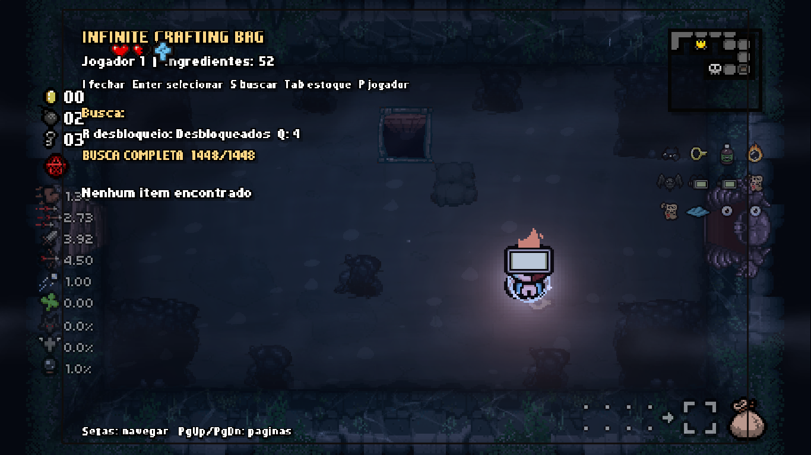
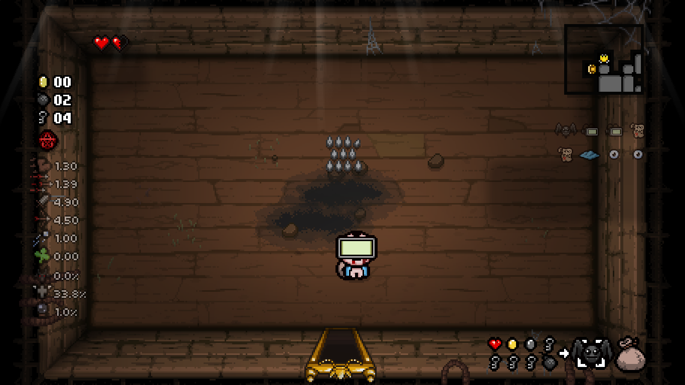

# Infinite Crafting Bag

Mod for The Binding of Isaac: Repentance+ with REPENTOGON. The Bag of Crafting stores collected ingredients in a virtual per-player inventory. The catalog previews possible results and prepares a recipe for crafting by holding Q outside the catalog.

## Screenshots





## Controls

- **I** opens or closes the catalog. While editing the search, press Enter or Escape to finish editing first.
- **S** edits the name search; type letters, numbers or spaces and use Backspace to delete. Enter confirms the search and Escape cancels the edit.
- **Enter** on a catalog result validates and prepares its recipe without consuming ingredients, closes the catalog, and shows the selected item beside the ingredient count. Hold **Q** for 1.2 seconds to craft once. Release early to cancel; after crafting, release Q and select a recipe again to craft another item.
- **Backspace** cancels the prepared recipe without consuming ingredients. While editing a search, it deletes a character instead.
- The mod displays the selected collectible in its own HUD. It never mirrors the recipe or writes the output into the native bag, so other mods can use its contents without encountering temporary ingredients. The selection is cleared after delivery or when stock becomes insufficient. If the native bag has ingredients, preparation is refused.
- **Up/Down** selects an item or scrolls the ingredient inventory; holding an arrow repeats after a short delay. **Page Up/Page Down** move through the item list.
- **R** cycles unlock filters (unlocked by default, all, locked). **Q** cycles quality filters (all, 0–4).
- **Tab** switches between the item list and ingredient inventory. **P** selects the next player.

The catalog considers only items discovered from the selected player's current stock. The unlock filter checks the item achievement against `PersistentGameData:Unlocked()`; items with no achievement are unlocked by default. Run restrictions are checked separately before crafting. The locked filter is not a complete list of all locked collectibles. Search uses the localized item name when available, ignores case and common Latin accents, and supports ASCII letters, digits and spaces.

During search editing, the catalog suppresses supported game actions for keyboard player zero and selected global menu actions through `MC_INPUT_ACTION`. It also intercepts standard Lua `Input` button and action queries for controller zero so other mods' shortcuts do not normally open during typing. Mods that retain an earlier function reference, bypass the wrapper explicitly, or read input through another mechanism can still react; some game actions such as pause are not polled through the callback. Enter and Escape return to the catalog; close it to restore normal movement and actions.

## Recipe search

The mod counts ingredients by type and generates bounded combinations of eight in sorted order, so permutations are evaluated once. Each combination is passed to REPENTOGON's `EntityPlayer.CalculateBagOfCraftingOutput`; the returned collectible ID identifies the entry, and the first discovered recipe is kept. Browsing and searching do not consume ingredients or grant collectibles.

The search runs while the catalog is open and, more slowly, in the background while it is closed and the selected player has the Bag of Crafting. Background search pauses with the game and runs at most one native calculation every five updates; the open catalog processes at most 128 traversal steps, 8 native recipe calculations, and 64 total combinations per update. Search stops after 50,000 combinations. The display distinguishes complete, in-progress, limited and error states, and reports evaluated combinations out of the total. Up to 10,000 calculated combinations are held in memory and reused after stock changes; a stock change still requires traversing the currently affordable combinations. The cache is discarded when the player, seed, room, achievement or observed item-pool state changes, and is not saved between sessions. These conservative invalidations help avoid stale previews; delivery always recalculates the chosen recipe. A bounded sprite cache holds up to 64 icons.

The native function calculates an output for one combination; it does not provide a reverse index of all recipes. The catalog is therefore incomplete while searching or after reaching the limit. Custom mods may change pools or availability in ways not covered by the observed callbacks; results are previews and require in-game verification. The native API documentation does not specify all side effects or detail every pool/unlock interaction, so those behaviors should be verified with the installed REPENTOGON version. No tables or assets from External Item Descriptions are required.

## Crafting and limitations

The mod does not load ingredients into the native Bag of Crafting during gameplay. The native bag and its output remain under the control of the game and other mods. REPENTOGON documents callbacks for adding pickups to the bag, but no documented callback identified here proves that the native bag finished crafting a specific recipe. The mod suppresses the player's pocket-item and drop actions while Q is held for a prepared recipe and controls the hold and delivery itself. If the selected item is nevertheless delivered externally while Q is held, the pending delivery is cancelled to avoid a second item; that external delivery does not debit the virtual stock. It refuses to craft if the native bag contains ingredients. The prepared recipe is temporary and must be selected again after Continue; the inventory remains persistent.

Preparation checks the player, unlock, stock and native recipe output. Run availability and active-slot restrictions are checked at delivery, so they do not prevent selecting an otherwise valid recipe. Before delivery the mod checks all of these conditions again, consumes eight ingredients and saves the resulting stock. It then calls `EntityPlayer:AddCollectible` once and observes `MC_POST_ADD_COLLECTIBLE`. A failed save or unexpected error before delivery attempts to restore and persist the ingredients. `AddCollectible` and SaveData do not form a transaction with the game's save. Other mods can cancel or change item delivery, override input callbacks, or have side effects; after the delivery call an uncertain outcome is logged and ingredients are not automatically refunded to avoid duplication. Item acquisition callbacks run, but the native Bag of Crafting animation and special crafting interactions are not reproduced. With Schoolbag and a free secondary slot, the mod relies on the game to move the existing active item there when adding the crafted item. When an occupied primary slot must be replaced, the mod asks the game to drop the selected active on a native pedestal and checks the slots before delivery. With two Schoolbag actives, it allows the other active to move temporarily to the primary slot before adding the crafted item. If both slots contain the same active, crafting is blocked because DropCollectible does not identify a slot. If the drop fails, it restores the ingredients and attempts to save the refund; the old item may already be on a pedestal if another effect changed the slot. Native pedestal charge and special-item behavior require in-game testing.

The installed `[RGON] (BETA) Tainted Cain Rework` implements its own crafting inventory and its own collectible delivery. The two crafting flows are independent; their joint behavior has not been validated and no integration is provided. Test this mod with the rework disabled first.

## Persistence

The inventory remains stored via the existing `Mod:SaveData` flow. `[ICB DEBUG]` logs include save/load diagnostics. Data that exists but is invalid is retained rather than overwritten.

## Tests

With Lua 5.3 or later, run from the project root:

```
lua tests/catalog_spec.lua
lua tests/catalog_ui_spec.lua
lua tests/storage_catalog_spec.lua
lua tests/crafting_spec.lua
```

The tests mock the Isaac API and native calculator; they cover preview isolation, selection and delivery, but do not verify HUD appearance or real recipe results. In-game verification with other mods remains necessary.

## In-game validation

1. Start or continue a Tainted Cain run, collect at least eight ingredients, and press **I**.
2. Check the ingredient inventory with **Tab**, then return to the list. Verify the progress changes to complete or explicitly reports an incomplete search.
3. Navigate the results and compare an eight-ingredient recipe and its output with the game's native Bag of Crafting behavior. Search for a displayed item and exercise both filters.
4. Select an item with Enter. Check the stock does not change, close with I, hold Q briefly and release; verify nothing is consumed or granted.
5. Hold Q for 1.2 seconds and watch the progress bar. Verify exactly eight ingredients are removed and one item is granted. Keep holding and confirm no second item appears.
6. Select another recipe, craft it, save and Continue. Verify the remaining stock; prepare the recipe again after Continue. Check active items with both empty and occupied primary slots, including pedestal charge and Schoolbag, and test other mods separately.

Crafting, progress display, input suppression and persistence after crafting require validation in Isaac.
